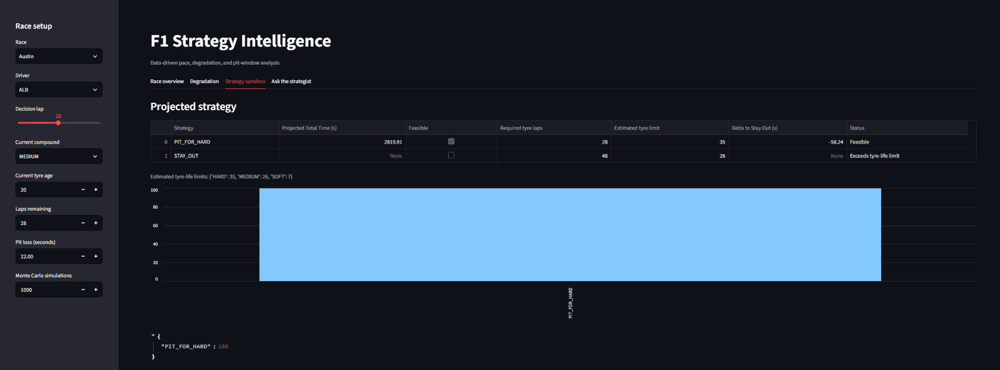
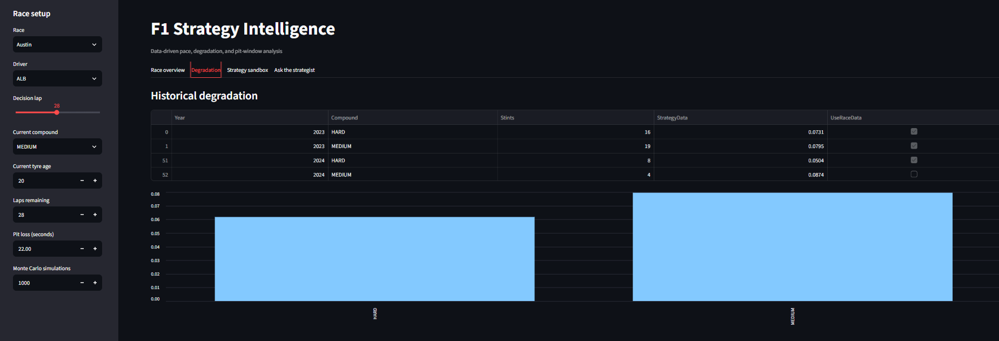

# F1 Strategy Intelligence

An interactive Formula 1 strategy simulator built with Python and Streamlit.
The application combines historical lap data, tyre degradation estimates,
compound pace offsets, tyre-life feasibility checks, and Monte Carlo simulation
to compare pit-stop decisions.

[Live demo](https://f1-race-strategy-simulator.streamlit.app/)

## Overview

The dashboard lets users:

- select a 2025 race and driver;
- inspect lap pace and tyre age;
- compare historical degradation by compound;
- test strategy decisions with interactive controls;
- view projected race-time differences;
- explore Monte Carlo strategy probabilities;
- request a natural-language explanation from the strategist panel.

The numerical simulator makes the recommendation first. The language model is
used only to explain the supplied results.

## Screenshots

The dashboard currently includes these views:

| Dashboard area | File |
|---|---|
| Strategy sandbox | `strategy-sandbox.png` |
| Degradation analysis | `degradation.png` |
| Strategist explanation | `ask-the-strategist.png` |






## Architecture

```text
Hugging Face lap data
          |
          v
     src/data.py
 Loading and preparation
          |
          v
   src/strategy.py
 Pace, degradation, feasibility,
 projections, and Monte Carlo
          |
     +-------------------+
     |                   |
     v                   v
app/run_strategy.py  app/dashboard.py
                         |
                         v
                   Optional Groq explanation
```

## Project structure

```text
f1-race-strategy-simulator/
├── app/
│   ├── dashboard.py       # Streamlit application
│   └── run_strategy.py    # Command-line strategy example
├── src/
│   ├── data.py            # Dataset loading and feature preparation
│   ├── model.py           # Lap-time model experiments
│   └── strategy.py        # Strategy engine
├── models/                # Small generated model and evaluation artifacts
├── docs/screenshots/       # README images
├── requirements.txt
└── README.md
```

## Strategy methodology

The engine follows this process:

1. Estimate the driver's recent current-stint pace.
2. Remove degradation already represented in that recent pace.
3. Estimate relative fresh-tyre pace offsets by compound.
4. Resolve degradation using exact-race, historical-circuit, and global data.
5. Project stay-out and pit-stop strategies.
6. Reject strategies that exceed historical tyre-life limits.
7. Perturb compound pace offsets, degradation, and pit-loss estimates in Monte
   Carlo simulations.

The strategy table reports both projected time and feasibility. When no
one-stint option can cover the remaining laps, the dashboard reports that a
multi-stint model is required instead of presenting an unrealistic winner.

## Run locally

From the project root:

```powershell
python -m pip install -r requirements.txt
python -m streamlit run app/dashboard.py
```

Open the local URL shown by Streamlit, normally:

```text
http://localhost:8501
```

The lap data is downloaded at runtime from the Hugging Face dataset configured
in `src/data.py`, so the full dataset does not need to be stored in the
repository.

To run the command-line example instead:

```powershell
python app/run_strategy.py
```

## Dependencies

- `requirements.txt` contains the full local application and modeling
  environment, including Streamlit and Groq.
- `requirements-deploy.txt` contains the deployment environment for the
  Streamlit app.
- `requirements-colab.txt` contains the notebook/Colab environment and omits
  the app-only packages.

## Optional strategist panel

The dashboard can use Groq to turn simulator facts into a concise explanation.
The numerical dashboard remains available without the optional language-model
connection.

For deployment, configure the Groq model provider through the hosting
platform's secret settings. Do not place credentials in source files or commit
them to the repository.

For local use, export `GROQ_API_KEY` in the shell before starting Streamlit.
The key is optional; the numerical simulator works without it.

## Model evaluation

The lap-time model experiment in `src/model.py` uses XGBoost to predict
absolute lap time and lap-time delta. On the 2025 test dataset, the
previous-lap baseline has an MAE of **0.361 seconds** and an RMSE of
**0.632 seconds**. The absolute-lap-time XGBoost model has an MAE of
**0.507 seconds** and an RMSE of **0.962 seconds** using the current feature
set. Running `python src/model.py` trains the XGBoost models and prints their
feature importance and diagnostic output.

The XGBoost experiment is separate from the strategy simulator: the simulator
uses the historical pace, degradation, and feasibility calculations rather than
the trained XGBoost prediction.

## Example evaluation

One evaluated example uses the 2025 Monaco race state for VER at lap 27:

| Item | Result |
|---|---|
| Current compound | HARD |
| Current tyre age | 27 laps |
| Evaluated pit option | PIT_FOR_MEDIUM |
| Historical action | PIT_FOR_MEDIUM |
| Simulator agreement | True |

This is an illustrative evaluation, not a claim that the simulator is a
complete race-prediction system.

## Limitations

- The current engine evaluates one-stint options and does not optimize complete
  multi-stop race plans.
- Historical compound offsets combine observations across drivers and teams,
  so they are estimates rather than controlled tyre tests.
- Tyre-life limits are heuristic estimates based on historical stint rows and
  may be affected by missing laps in the source data.
- Pit loss is currently an input assumption rather than a fully inferred
  circuit model.
- Safety cars, traffic, weather changes, tyre availability, and team
  information are not fully modeled.
- Runtime data loading requires network access on first launch.

## Dataset and credit

This project uses the F1 strategy dataset created by Víctor Vega:

<https://huggingface.co/datasets/VforVitorio/f1-strategy-dataset>

Please follow the dataset's license and attribution requirements when sharing or
extending this project.
